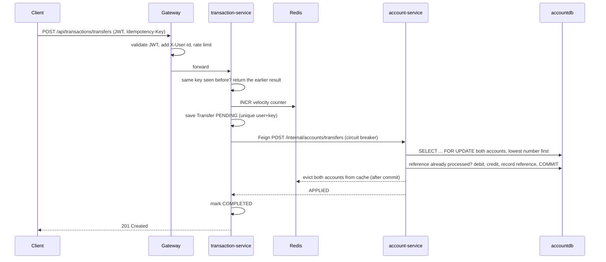

# PayFlow: Digital Banking Microservices

A production-style banking backend: customers sign up, open accounts, deposit money and send
transfers. It is built to exercise a full Java backend skill set in one realistic codebase, and
every design choice below has a reason you can explain in an interview.

## Architecture

```mermaid
flowchart LR
    C[Client / Postman / demo.sh] -->|HTTPS + JWT| GW[api-gateway<br/>Spring Cloud Gateway]
    GW -->|rate limit| R[(Redis)]
    GW --> AUTH[auth-service]
    GW --> ACC[account-service]
    GW --> TXN[transaction-service]
    TXN -->|OpenFeign + Circuit Breaker<br/>/internal/accounts/transfers| ACC
    ACC -->|@Cacheable| R
    TXN -->|velocity counters| R
    AUTH --> PG1[(authdb)]
    ACC --> PG2[(accountdb)]
    TXN --> PG3[(transactiondb)]
    AUTH & ACC & TXN & GW -.register / discover.-> EU[discovery-server<br/>Eureka]
```

| Module | Port | Responsibility |
|---|---|---|
| `discovery-server` | 8761 | Eureka service registry |
| `api-gateway` | 8080 | Single entry point: routing, JWT validation, Redis rate limiting |
| `auth-service` | 8081 | Registration, login, BCrypt passwords, JWT issuing, admin seeding |
| `account-service` | 8082 | Customers and accounts, balances, Redis cache, row-locked transfers |
| `transaction-service` | 8083 | Transfer orchestration, idempotency, bulk transfers, retries, statements |
| `concurrency-lab` | n/a | Runnable plain-Java labs: race conditions, deadlocks, queues, CompletableFuture, streams |

## Where each skill is used

| Skill | Where to look |
|---|---|
| **Java 8** | Lambdas, streams, `Collectors.groupingBy/reducing/partitioningBy`, `Optional`, method references, `java.time`, `CompletableFuture`: `StatementService`, `BulkTransferService`, `concurrency-lab/Java8StreamsLab` |
| **Java 17** | Records for DTOs, `switch` expressions, pattern-matching `instanceof`, text blocks in JPQL |
| **Multithreading & concurrency** | Bounded `ThreadPoolTaskExecutor` with back-pressure and MDC propagation (`ExecutorConfig`); parallel fan-out/fan-in (`BulkTransferService`); lock ordering against deadlocks (`AccountService.applyTransfer`); atomic distributed counters (`VelocityGuard`); `concurrency-lab` for `synchronized`, `AtomicLong`, `LongAdder`, `ReentrantLock.tryLock`, `CountDownLatch`, `BlockingQueue` |
| **Spring Core** | Constructor injection everywhere; `@Configuration`/`@Bean`; AOP audit aspect (`AuditAspect` + `@Auditable`); application events with `@TransactionalEventListener`; `@Async`; type-safe `@ConfigurationProperties` records; programmatic `TransactionTemplate` |
| **Spring Boot** | Starters, auto-configuration, Actuator health groups for Kubernetes probes, RFC 7807 `ProblemDetail` errors, Bean Validation, graceful shutdown, `@Scheduled` |
| **Spring Cloud** | Eureka discovery, Gateway routing (`lb://`), Gateway `RequestRateLimiter`, OpenFeign client with custom `ErrorDecoder` and `RequestInterceptor`, Resilience4j circuit breaker with fallback |
| **Spring Security** | `SecurityFilterChain` (stateless), `UserDetailsService`, `BCryptPasswordEncoder`, `AuthenticationManager`, JWT (jjwt 0.12), custom `OncePerRequestFilter`, `@EnableMethodSecurity` + `@PreAuthorize("hasRole('ADMIN')")`, `@AuthenticationPrincipal`, custom `AuthorizationManager` for service-to-service key |
| **Microservices** | Database per service, API gateway, service discovery, idempotent APIs, sync service-to-service calls with resilience, correlation id across services, reconciliation of unknown outcomes |
| **JPA / Hibernate** | Entity mapping, `@OneToMany`/`@ManyToOne` (LAZY) with helper methods, `@Version` optimistic locking, `PESSIMISTIC_WRITE` locks, `@CreationTimestamp`/`@UpdateTimestamp`, `@BatchSize`, JDBC batching, `Persistable` for assigned ids, `update versioned` HQL, `open-in-view: false` |
| **Spring Data JPA** | Derived queries, `@Query` JPQL with `join fetch`, `@EntityGraph`, `@Modifying` bulk update, `@Lock`, `@QueryHints`, paging and sorting with `Pageable`, `findTop50By...` |
| **Docker** | One multi-stage `Dockerfile` for all services (build cache mount, non-root numeric UID, container-aware heap), `docker-compose.yml` with health-checked start order |
| **Kubernetes** | Namespace, ConfigMap, Secret, StatefulSet + PVC for Postgres, Deployments with readiness/liveness probes, rolling updates with zero unavailability, `preStop` hook, resource requests/limits, read-only root FS, HPA, Ingress, NetworkPolicy |
| **Caching / Redis** | Cache-aside with `@Cacheable` + JSON serializer + TTL; eviction **after commit**; `CacheErrorHandler` so Redis outages fall back to DB; Redis token-bucket rate limiting at the gateway; Redis `INCR` velocity limits |

## The money transfer flow (the heart of the project)



What can go wrong, and what handles it:

| Failure | Protection |
|---|---|
| Client retries after a timeout | `Idempotency-Key` + unique DB constraint: second call returns the first result |
| Two transfers hit the same account at once | `SELECT ... FOR UPDATE` row locks; lock timeout returns 409 and the transfer is retried |
| A->B and B->A at the same moment | Locks always taken in account-number order, so no deadlock cycle can form |
| account-service down or slow | Circuit breaker fails fast; transfer stays `PENDING`; `ReconciliationJob` retries |
| Retry after the debit already committed | account-service keeps a `processed_transfers` ledger in the same DB transaction, so it never applies a reference twice |
| Still no answer after many retries | Status becomes `NEEDS_REVIEW`, never a false `FAILED` |
| Stale balance in cache | Eviction runs only after commit; TTL bounds staleness; DTOs cached, never entities |
| Redis outage | Cache errors are logged and the DB is used; velocity check fails open (balances are still safe) |
| Spoofed `X-User-Id` header | Gateway strips client copies; services are internal-only (NetworkPolicy) |

## Run it

### Option A: Docker Compose (everything, one command)

```bash
cp .env.example .env              # optional: change secrets
docker compose up --build -d      # first build downloads dependencies, give it a few minutes
docker compose ps                 # wait until services are healthy
./scripts/demo.sh                 # end-to-end walkthrough (needs curl + jq)
```

Eureka dashboard: http://localhost:8761. Default admin: `admin` / `Admin@12345`.
Inspect the cache: `docker compose exec redis redis-cli keys 'payflow:*'`.

### Option B: Run services from your IDE

```bash
docker compose up -d postgres redis
mvn clean install
# then start in this order: discovery-server, auth-service, account-service, transaction-service, api-gateway
mvn -pl account-service spring-boot:run
```

### Option C: Kubernetes (minikube)

```bash
minikube start --cpus 4 --memory 8g
minikube addons enable ingress
minikube addons enable metrics-server
eval $(minikube docker-env)       # build images straight into minikube's Docker
for m in discovery-server auth-service account-service transaction-service api-gateway; do
  docker build --build-arg MODULE=$m -t payflow/$m:1.0.0 .
done
kubectl apply -k k8s/
kubectl -n payflow get pods -w
kubectl -n payflow port-forward svc/api-gateway 8080:8080
./scripts/demo.sh
```

Try: `kubectl -n payflow delete pod -l app=account-service` while running transfers and watch them
go `PENDING` then complete via reconciliation.

### Concurrency lab (no infrastructure needed)

```bash
mvn -pl concurrency-lab package && java -jar concurrency-lab/target/app.jar
```

Sample output: a plain `long` loses about 50,000 of 800,000 updates; the naive transfer ordering hits
hundreds of would-be deadlocks while ordered locking hits zero; three parallel calls finish in about
300 ms instead of 2.6 s.

## API

All routes go through the gateway on port 8080. Everything except `/api/auth/**` needs `Authorization: Bearer <token>`.

| Method | Path | Notes |
|---|---|---|
| POST | `/api/auth/register` | `{username, email, password}` → token |
| POST | `/api/auth/login` | `{username, password}` → token |
| POST | `/api/accounts` | `{type: CHEQUING or SAVINGS, currency?}` |
| GET | `/api/accounts/mine` | caller's accounts |
| GET | `/api/accounts/mine/summary` | total active balance |
| GET | `/api/accounts/{number}` | cached in Redis |
| POST | `/api/accounts/{number}/deposits` | `{amount}` |
| GET | `/api/accounts?status=ACTIVE&page=0&size=20` | ADMIN |
| POST | `/api/accounts/{number}/freeze` | ADMIN |
| POST | `/api/accounts/customers/{userId}/freeze` | ADMIN, bulk JPQL update |
| POST | `/api/transactions/transfers` | header `Idempotency-Key`; 201 / 202 / 422 / 200 (replay) |
| POST | `/api/transactions/transfers/bulk` | `{items: [{idempotencyKey, transfer}]}` up to 100 |
| GET | `/api/transactions/transfers/{reference}` | own transfers only |
| GET | `/api/transactions/transfers?page=0&size=20` | history |
| GET | `/api/transactions/summary?days=30` | stats built with streams |

Errors are RFC 7807 JSON with a stable `code`, e.g. `INSUFFICIENT_FUNDS`, `ACCOUNT_NOT_ACTIVE`,
`IDEMPOTENCY_KEY_REUSED`, `VELOCITY_LIMIT`, `CONCURRENT_UPDATE`.

## Interview talking points

1. **Why pessimistic locks for transfers but `@Version` too?** Transfers are short, high-contention
   writes on hot rows: waiting briefly beats failing and retrying. `@Version` still protects slower
   read-modify-write paths (admin edits) and the transfer record in transaction-service.
2. **Why not one `@Transactional` around the transfer orchestration?** It would hold a DB connection
   and locks during a remote HTTP call. `TransactionTemplate` keeps DB transactions short.
3. **Why evict the cache after commit?** Evicting inside the transaction lets a concurrent reader
   reload the old value and re-cache it just before the commit.
4. **Why a dedicated thread pool for bulk work?** The common ForkJoinPool is shared JVM-wide and sized
   for CPU work; blocking I/O there starves everything else. A bounded queue with `CallerRunsPolicy`
   gives back-pressure instead of memory exhaustion.
5. **Why does the circuit breaker ignore `TransferRejectedException`?** "Insufficient funds" means
   account-service is healthy; only technical failures should open the circuit.
6. **What happens on a timeout after money moved?** The outcome is unknown, so the transfer stays
   `PENDING`; retries are safe because account-service is idempotent on the reference.
7. **How would you go further?** Kafka outbox for events and notifications, Flyway migrations,
   ShedLock for the scheduled job, OpenTelemetry tracing, Testcontainers integration tests,
   Spring Cloud Config, refresh tokens and key rotation.

## Project layout

```
payflow/
├── pom.xml                      parent (Spring Boot 3.3, Spring Cloud 2023.0, Java 17)
├── Dockerfile                   builds any module: --build-arg MODULE=...
├── docker-compose.yml
├── docker/postgres/init.sql     one database per service
├── k8s/                         kubectl apply -k k8s/
├── scripts/demo.sh              end-to-end demo
├── concurrency-lab/
├── discovery-server/
├── api-gateway/
├── auth-service/
├── account-service/
└── transaction-service/
```
